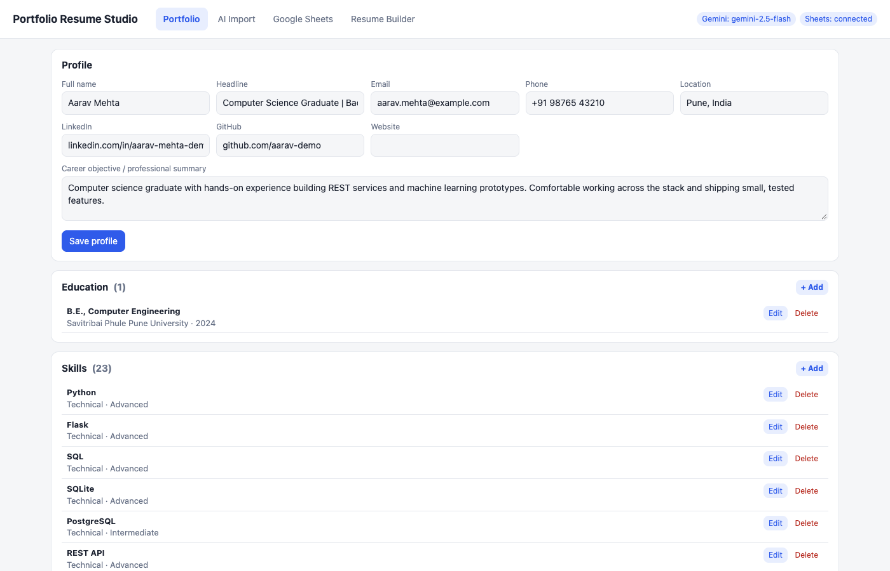
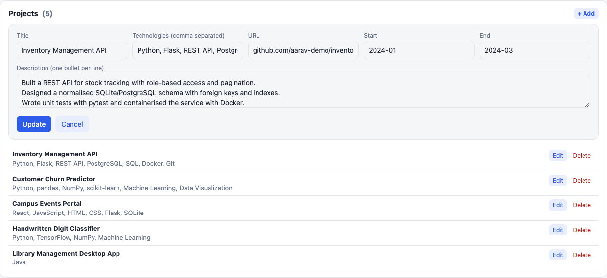
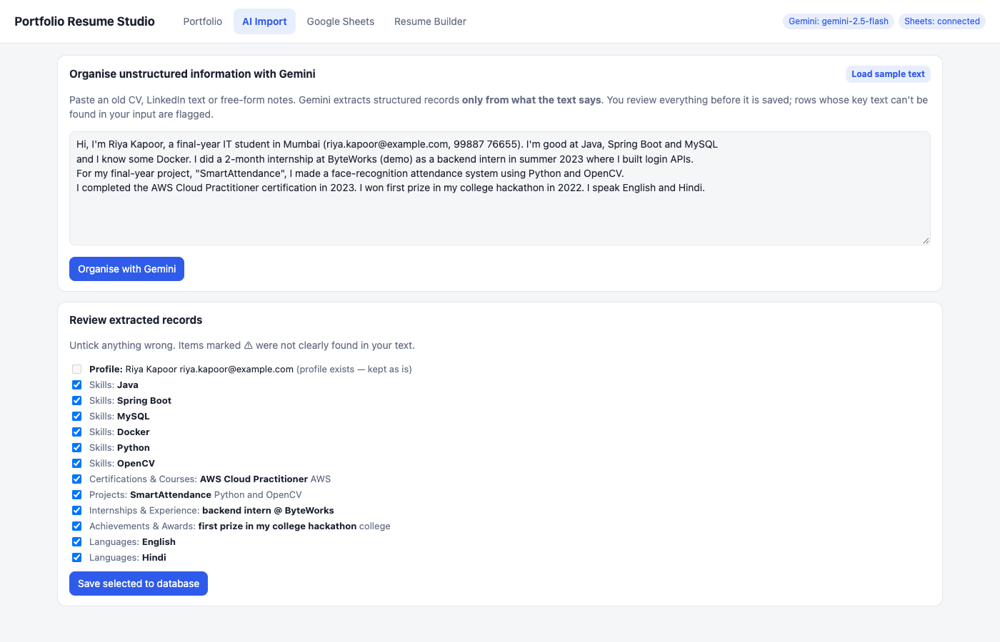
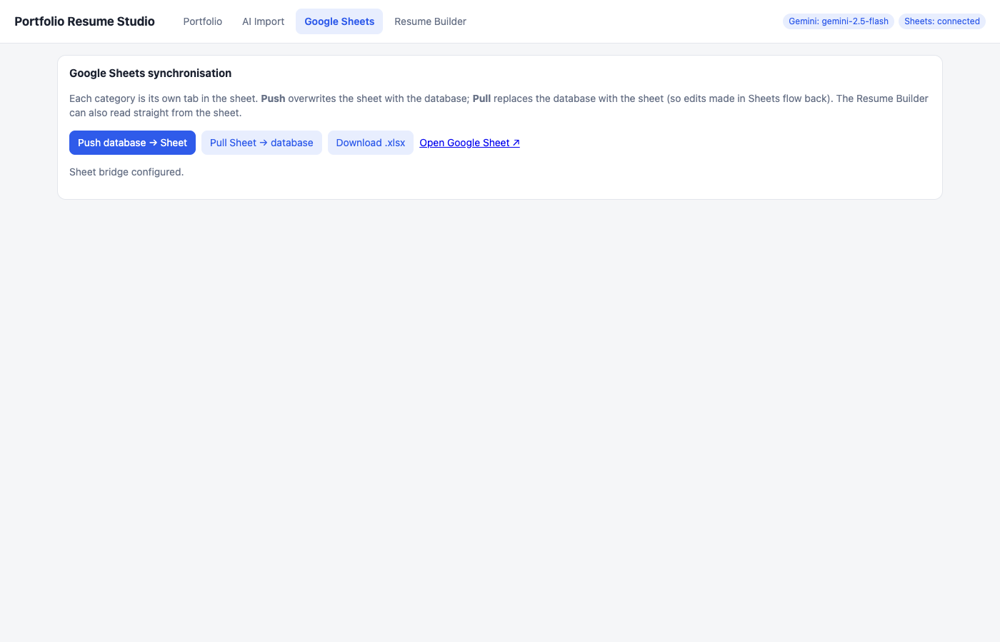
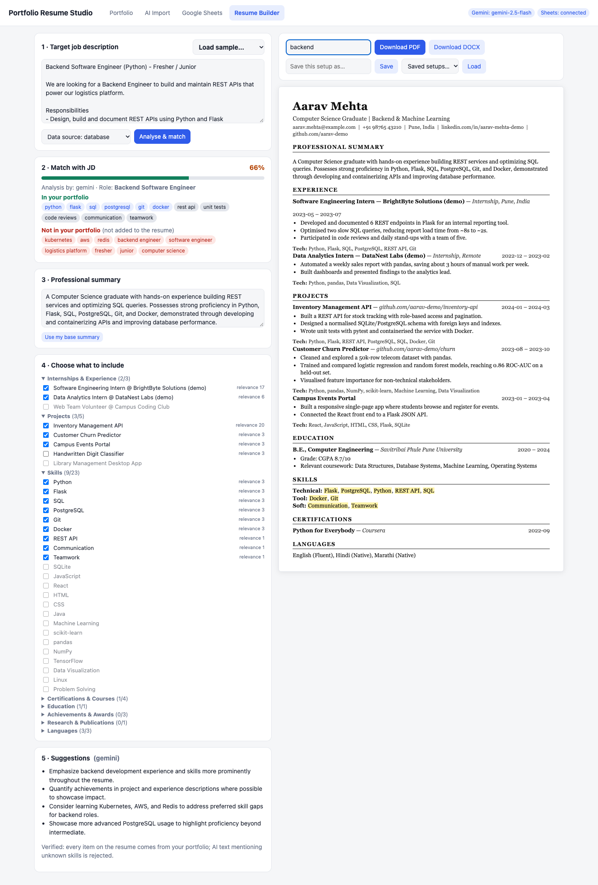
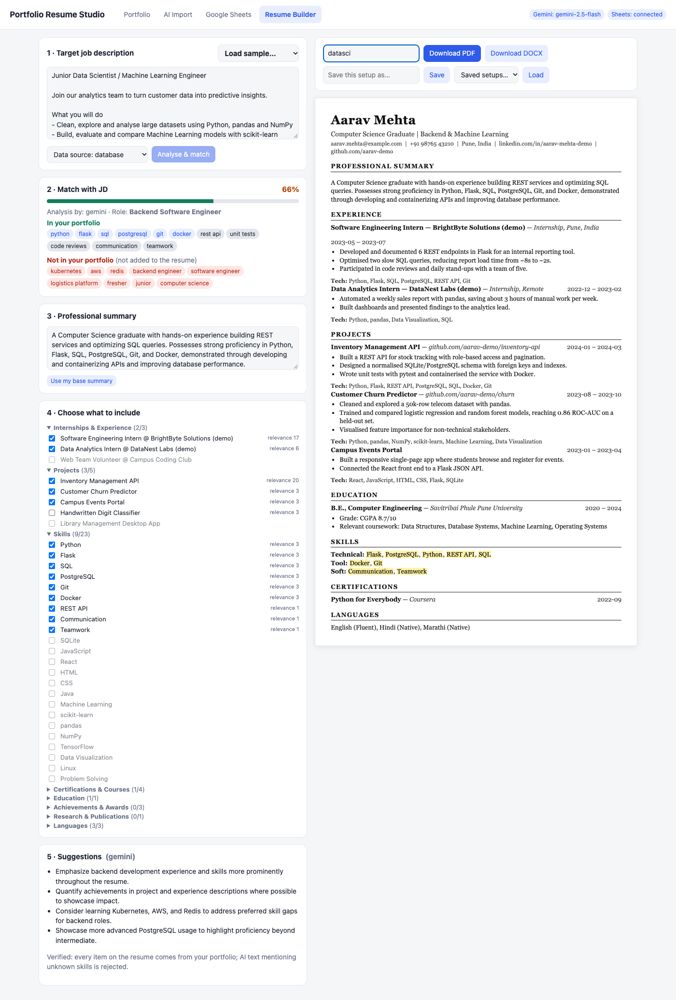

# Portfolio Resume Studio

An AI-powered portfolio database and dynamic resume generator. Keep all your professional information in one place, sync it to Google Sheets, paste a job description, and get a tailored, **verified** resume as PDF or DOCX.

**Stack:** Flask · SQLite · Gemini API · Google Sheets (Apps Script bridge) · ReportLab (PDF) · python-docx (DOCX) · vanilla JS UI

**Google Sheet (view only):** https://docs.google.com/spreadsheets/d/1uSfBSVxK-5Ow-j83_8859Q0IBYenRrp1Y8_lgwoNneE/edit?usp=sharing

> All personal data in this repo is dummy sample data ("Aarav Mehta"). No API keys or secrets are committed.

---

## Features

| Module | What it does |
|---|---|
| **Portfolio database** | Profile, education, skills, certifications, projects, internships/experience, achievements, publications, languages. Full add / edit / delete UI. |
| **Gemini: organise** | Turns pasted, unstructured text (old CV, notes) into structured records. You review every row before it is saved. |
| **Gemini: JD analysis** | Extracts role, required/preferred skills, keywords and qualifications from a job description. |
| **Matching** | Compares the JD with your portfolio: match %, matched vs. missing terms, relevance score for every project/experience/skill. |
| **Suggestions** | Tailored professional summary and improvement tips. |
| **Google Sheets sync** | One tab per category. Push DB → Sheet, pull Sheet → DB, or build resumes directly from the Sheet. `.xlsx` export works with no setup. |
| **Resume builder** | Select/deselect any item, edit the summary, live preview that refreshes on every change, save/load setups. |
| **Export** | Download PDF (and DOCX). JD keywords are highlighted in the skills section of the preview. |

## No invented facts: how it is enforced

The assignment requires that the system never fabricates qualifications. This is enforced in code, not just in the prompt:

1. **The resume is built from portfolio row IDs.** Text is copied from stored rows; unknown IDs are dropped (`resume.build`).
2. **Matching and scoring are deterministic** code over stored data (`gemini.match_portfolio`), not model output. JD skills you don't have appear under *Not in your portfolio* and are never added.
3. **Gemini's JD terms must literally appear in the JD** text, otherwise they are discarded.
4. **Gemini's summary is verified** (`verify_text`): if it mentions any technology absent from your portfolio, it is rejected and replaced with a grounded summary, and the user sees a note.
5. **Organise-from-text is a draft only.** Rows whose key text can't be found in the source are flagged ⚠, and nothing is saved without confirmation.
6. Without a Gemini key the app falls back to keyword matching and says so in the UI.

## Architecture

```
static/index.html ──► app.py (Flask REST API)
                         ├─ db.py        SQLite storage, CRUD, schema (schema.sql)
                         ├─ gemini.py    Gemini calls + matching + verification
                         ├─ sheets.py    Sheet <-> DB sync via Apps Script web app
                         └─ resume.py    HTML preview / PDF / DOCX renderers
apps_script/Code.gs  ◄── deployed in your Google Sheet (doPost / doGet)
```

**Database** (`schema.sql`): `profile` is the root; every category table has `profile_id → profile(id)` with `ON DELETE CASCADE`. `item_skills` is a many-to-many link between projects/experience and skills (derived from each entry's `technologies`; only skills that already exist are linked). `resume_configs` stores saved JD + selection setups.

## Setup

Requires Python 3.10+.

```bash
git clone https://github.com/saiyash07/PortfolioBuilder.git
cd PortfolioBuilder
python3 -m venv .venv && source .venv/bin/activate
pip install -r requirements.txt
cp .env.example .env        # then fill in values (see below)
python app.py               # http://127.0.0.1:5050
```

The database is created and filled with sample data on first run. Run the tests with `python -m pytest -q tests`.

### 1. Gemini API
1. Create a key at <https://aistudio.google.com/apikey>.
2. Set `GEMINI_API_KEY` in `.env` (optional: `GEMINI_MODEL`, default `gemini-2.5-flash`).

The key stays on the server; it is never sent to the browser, and `.env` is git-ignored.

### 2. Google Sheets
1. Create a blank Google Sheet → **Extensions → Apps Script**, paste `apps_script/Code.gs`, save.
2. **Project Settings → Script properties**: add `SECRET` = a long random string (e.g. `openssl rand -hex 24`).
3. **Deploy → New deployment → Web app**: Execute as *Me*, access *Anyone*. Copy the `/exec` URL.
4. In `.env` set `SHEETS_WEBAPP_URL`, `SHEETS_SECRET` (same value as `SECRET`) and `SHEET_PUBLIC_URL`.
5. In the app open **Google Sheets → Push database → Sheet**.

If you change `Code.gs` later, redeploy with **Manage deployments → Edit → New version**.

## Demo workflow
1. **Portfolio** – browse and edit entries.
2. **AI Import** – load the sample text, *Organise with Gemini*, review, save.
3. **Google Sheets** – *Push database → Sheet*.
4. **Resume Builder** – load the *Backend (Python)* JD → *Analyse & match* → adjust selections/summary → *Download PDF*.
5. Load the *Data / ML* JD and repeat. The same portfolio produces two different resumes.

## Screenshots

All in [`screenshots/`](screenshots/), using the sample data.

| | |
|---|---|
| **Portfolio database** | **Edit an entry** |
|  |  |
| **Gemini organises unstructured text** | **Sheets sync** |
|  |  |

**Backend (Python) JD: match, selections, preview**


**Data / ML JD: match, selections, preview**


**Google Sheet after a push** (one tab per category): [profile](screenshots/07_google_sheet_profile_tab.png) · [education](screenshots/08_google_sheet_education_tab.png) · [skills](screenshots/09_google_sheet_skills_tab.png) · [certifications](screenshots/10_google_sheet_certifications_tab.png) · [projects](screenshots/11_google_sheet_projects_tab.png) · [experience](screenshots/12_google_sheet_experience_tab.png) · [achievements](screenshots/13_google_sheet_achievements_tab.png) · [publications](screenshots/14_google_sheet_publications_tab.png) · [languages](screenshots/15_google_sheet_languages_tab.png)

## Sample job descriptions and generated resumes

Two JDs ([`samples/jd_backend_python.txt`](samples/jd_backend_python.txt), [`samples/jd_data_ml.txt`](samples/jd_data_ml.txt)) produce two different resumes from the same portfolio (different projects, experience order, skills and summary):

| JD | Gemini-generated PDF | DOCX |
|---|---|---|
| Backend Software Engineer (Python) | [PDF](sample_outputs/Aarav_Mehta_Backend_Python_Resume_gemini.pdf) | [DOCX](sample_outputs/Aarav_Mehta_Backend_Python_Resume.docx) |
| Junior Data Scientist / ML Engineer | [PDF](sample_outputs/Aarav_Mehta_Data_ML_Resume_gemini.pdf) | [DOCX](sample_outputs/Aarav_Mehta_Data_ML_Resume.docx) |

The DOCX files and the un-suffixed PDFs were produced in keyword-fallback mode (no Gemini key); `sample_outputs/portfolio_sheet.xlsx` is the `.xlsx` export.

## Project layout

```
app.py               Flask API + routes          schema.sql        database schema
db.py                storage layer               apps_script/      Google Sheets bridge
gemini.py            AI, matching, verification  samples/          sample portfolio + JDs
sheets.py            Sheets sync / xlsx export   sample_outputs/   generated resumes
resume.py            HTML / PDF / DOCX           screenshots/      workflow screenshots
static/index.html    UI                          tests/            pytest suite
```

## Security notes
- API keys and the Sheets secret live only in `.env` (git-ignored) on the server.
- The Apps Script web app is protected by a shared secret checked on every call.
- Upload size is capped and all user text is HTML-escaped in the UI and previews.
